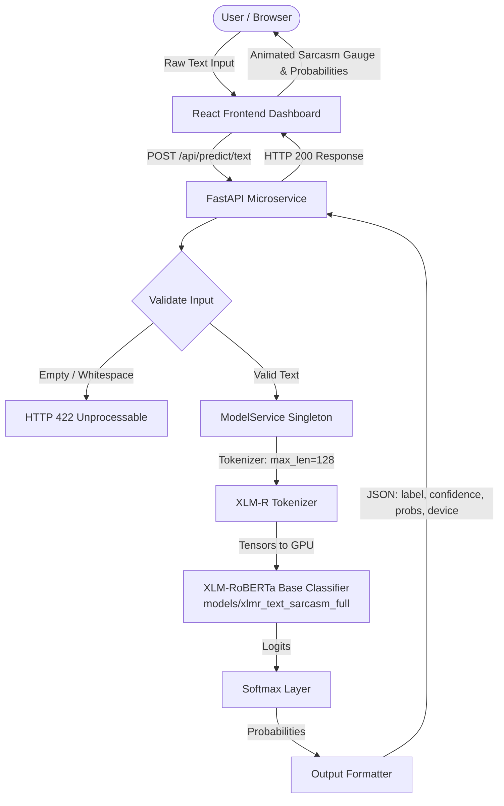
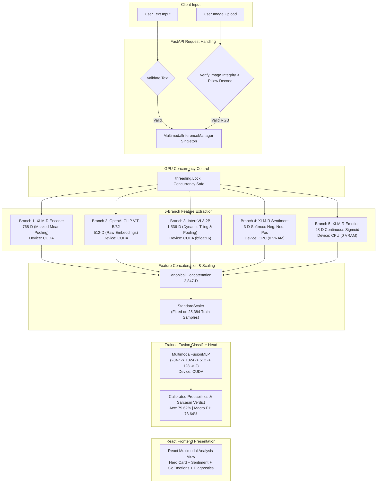

# COMPLETE SYSTEM ARCHITECTURE: MULTIMODAL SARCASM INTELLIGENCE SYSTEM

**Audit Date:** October 10, 2026 (Updated post-Milestone 5 execution)  
**Project Root:** `D:\NLP_PROJECT`  

---

## 1. Architectural Overview: Current vs. Target

The system is designed as an advanced multimodal sarcasm intelligence platform targeting nuanced social media and Gen-Z communication patterns (slang, internet acronyms, emoji incongruity, multimodal dissonance).

### Current State Architecture (Verified Post-Milestone 5)
- **Text-Only Sarcasm Detection:** End-to-end operational. Raw text is submitted via React to FastAPI `/api/predict/text`. XLM-RoBERTa base model (`models\xlmr_text_sarcasm_full`) preloaded in GPU VRAM performs contextual sequence classification and returns calibrated sarcasm probabilities (<25 ms).
- **Request-Time Multimodal Inference (`POST /api/predict/multimodal`):** 
  - Fully operational and tested.
  - Accepts raw text and uploaded image via `multipart/form-data`.
  - Dynamically runs all five feature extraction branches:
    1. **768-D** contextual text embedding via XLM-RoBERTa encoder (`models\xlmr_text_sarcasm_full`, masked mean pooling).
    2. **512-D** visual embedding via OpenAI CLIP ViT-B/32 (CUDA).
    3. **1,536-D** visual semantic representation via InternVL3-2B (CUDA, bfloat16, dynamic tiling).
    4. **3-D** sentiment probability distribution via XLM-R Sentiment model (CPU, [Negative, Neutral, Positive]).
    5. **28-D** multi-label emotion probability distribution via XLM-R GoEmotions model (CPU, sigmoid continuous).
  - Concatenates into canonical 2,847-dimensional representation.
  - Normalizes using pre-fitted training `StandardScaler`.
  - Executes trained `MultimodalFusionMLP` (Test Acc: 79.62%, Macro F1: 78.64%, Sarcastic F1: 83.21%).
  - Returns structured prediction verdict, calibrated probabilities, sentiment polarity, 28-emotion spectrum, and latency breakdown.
- **React Frontend Dashboard Integration:**
  - Interactive Multimodal Analysis card in `frontend/src/pages/MultimodalAnalysis.tsx` connects directly to `POST /api/predict/multimodal`.
  - Live visualizers for class probabilities, sentiment breakdown, GoEmotions distribution, and architecture diagnostics.

---

## 2. Text-Only Inference Flow (Operational)



---

## 3. Real Request-Time Multimodal Inference Flow (Operational)



---

## 4. Dimensionality Breakdown & Layer Specifications

| Vector Component | Source Architecture | Extraction Target | Dimensionality | Role in Sarcasm Detection | Verified Status |
| :--- | :--- | :--- | :---: | :--- | :---: |
| **$F_{\text{text}}$** | XLM-RoBERTa Base | Masked mean-pooled embedding | **768** | Core linguistic semantics, syntax, social slang | **Request-Time Live (CUDA)** |
| **$F_{\text{clip}}$** | OpenAI CLIP ViT-B/32 | Dense visual embedding | **512** | Global visual scene composition, object representations | **Request-Time Live (CUDA)** |
| **$F_{\text{vlm}}$** | InternVL3-2B | Vision-Language representation | **1,536** | Fine-grained visual understanding, meme text context | **Request-Time Live (CUDA)** |
| **$F_{\text{sent}}$** | XLM-R Sentiment | Softmax output distribution | **3** | Sentiment valence for sentiment contrast detection | **Request-Time Live (CPU)** |
| **$F_{\text{emo}}$** | XLM-R Emotion | Multi-label sigmoid distribution | **28** | Fine-grained affective states (irony, amusement, anger) | **Request-Time Live (CPU)** |
| **$F_{\text{fused}}$** | **Concatenated Representation** | **$F_{\text{fused}} \in \mathbb{R}^{2847}$** | **2,847** | **Complete Multimodal Sarcasm Representation** | **Canonical Concatenation (0-2846)** |
| **Classifier Head** | **MultimodalFusionMLP** | **2-Class Calibrated Output** | **2** | **Final Multimodal Sarcasm Prediction** | **LIVE INFERENCE (79.62% Acc, 78.64% F1)** |

---

## 5. Backend Service Architecture & Endpoints

FastAPI endpoints verified in `backend\app\main.py`:
- `GET /` — API Information (`200 OK`)
- `GET /api/health` — Health check, model load status, multimodal readiness (`200 OK`)
- `GET /api/model/status` — Model name, CUDA device, VRAM allocation, readiness (`200 OK`)
- `GET /api/model/metrics` — Empirical test results (`200 OK`)
- `GET /api/dataset/stats` — Summary statistics of all 4 datasets (`200 OK`)
- `GET /api/features/status` — Feature pipeline status: XLM-R, CLIP, InternVL, Sentiment, Emotion, Fusion Classifier all `READY` (`200 OK`)
- `POST /api/predict/text` — Live XLM-R text inference with softmax probabilities (`200 OK`)
- `POST /api/predict/multimodal` — **Live 5-branch multimodal inference + 2,847-D fusion MLP classification** (`200 OK`)
- `POST /api/predict/explain` — **Dedicated Local Explainable AI Reasoner endpoint** (`200 OK`)

---

## 6. Local Explainable AI Reasoner Flow (Operational)

```mermaid
flowchart TD
    subgraph Authoritative Classifier
        MInference[Multimodal Forward Pass] --> PredOutput[Authoritative Prediction\nLabel & Class Probabilities Frozen]
    end

    subgraph Visual Evidence Derivation
        ImgInput[User Image] --> InternVL[Resident InternVL3-2B on CUDA\nbfloat16 | 1-Sentence Factual Description]
        InternVL --> VisEvidence[Verified Visual Observations]
    end

    subgraph Hardware-Isolated Reasoner
        PredOutput --> PromptAssembler[Structured XAI Prompt Context]
        VisEvidence --> PromptAssembler
        TxtInput[User Text] --> PromptAssembler
        SentOutput[Sentiment Probabilities] --> PromptAssembler
        EmoOutput[GoEmotions Probabilities] --> PromptAssembler

        PromptAssembler --> CPU_LLM["Ollama llama3.2:1b\n(Host System CPU | num_gpu: 0 | 0 MB VRAM Delta)"]
        CPU_LLM -->|Timeout or Malformed| Fallback["Deterministic Cognitive Reasoner\n(<1 ms Latency | Local Rule-Grounded)"]
        CPU_LLM -->|JSON Response| SchemaValidator[Pydantic Schema Validator]
        Fallback --> SchemaValidator
    end

    subgraph Frontend Presentation
        SchemaValidator --> XAIPanel["React XAI Explanation Panel\nSummary, Lexical Evidence, Visual Observation, Affective Signals, Limitations"]
    end
```
