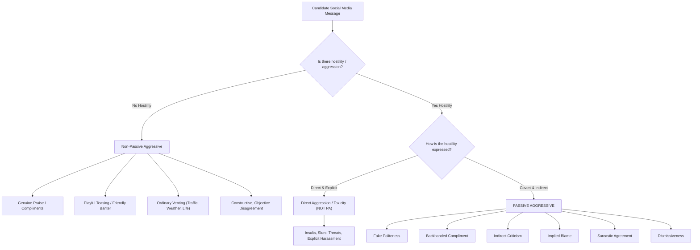

# Phase 4 Human Annotation Guidelines for Multimodal Passive-Aggression Detection
**Project Title:** Context-Aware Multimodal Passive-Aggression Detection in Social Media Using Image–Comment Fusion  
**Artifact:** `docs/phase4/annotation_guidelines.md`  
**Date:** October 21, 2026  
**Version:** 4.0.0 (Gold Standard Protocol)  

---

## 1. Operational Definition of Passive Aggression

Passive aggression is defined as:
> **Indirect communication that provides evidence of interpersonal hostility, resentment, blame or criticism, rather than merely expressing negative sentiment, sarcasm, or disagreement.**

The critical hallmark of passive aggression is the **covert concealment of interpersonal hostility** behind polite, ambiguous, or ostensibly neutral phrasing. The aggression is intentionally deniable, relying on pragmatic inference, conversational context, or multimodal incongruity to deliver the critique.

---

## 2. Core Boundary Distinctions (What Passive Aggression Is NOT)

To ensure high inter-annotator reliability and prevent category inflation, annotators must adhere to these strict contrast boundaries:

### Detailed Contrast Rules:
1. **Sarcasm vs. Passive Aggression:**
   - *Sarcasm without Passive Aggression:* Sarcastic comments that invert meaning without attacking a person (*"Oh fantastic, the train is delayed by an hour again!"*) are NOT passive aggressive.
   - *Sarcasm WITH Passive Aggression:* Sarcasm weaponized against an individual (*"So wonderful to see you finally decided to join the team meeting today"*) IS passive aggressive.
2. **Direct Toxicity / Aggression vs. Passive Aggression:**
   - Overt verbal attacks (*"You are completely incompetent and an idiot"*) are direct toxicity, NOT passive aggression. Passive aggression requires plausible deniability.
3. **Ordinary Negative Sentiment:**
   - Expressions of frustration, grief, sadness, or exhaustion that do not direct interpersonal resentment toward the reader or post author are NOT passive aggressive.
4. **Friendly Teasing & Inside Jokes:**
   - Banter between friends that carries positive or affectionate social bonding is NOT passive aggressive.

---

## 3. Primary Classification Schema

Annotators must assign exactly one primary label:

| Label Code | Label Meaning | Decision Criteria |
|---|---|---|
| `passive_aggressive` | Covert Interpersonal Hostility | Plausibly deniable hostility, blame, resentment, or indirect criticism directed at a person. |
| `non_passive_aggressive` | Neutral / Supportive / Direct / Banter | Sincere praise, neutral inquiries, friendly jokes, direct critique, or venting about external objects. |
| `ambiguous` | Unverifiable Intent / Context Starvation | The comment is ambiguous (*"Fine."*, *"Whatever you say."*), and available image/context is insufficient to determine intent. |

> **IMPORTANT RULE:** Never force a binary label. If the social media post lacks conversational history and intent cannot be reasonably verified, select `ambiguous`.

---

## 4. Secondary Subtype Taxonomy

When `passive_aggressive` is selected, annotators assign one dominant subtype:

1. **`fake_politeness`:** Using exaggerated formal manners, honorifics, or bureaucratic courtesy to deliver an insult (*"With all due respect...", "Per my previous email which was clearly ignored..."*).
2. **`indirect_criticism`:** Critiquing someone without naming them or by questioning general standards to target a specific individual (*"Interesting how some people never clean their dishes..."*).
3. **`backhanded_compliment`:** A compliment paired with an insult or diminishing qualifier (*"You look surprisingly professional today!"*).
4. **`implied_blame`:** Subtly attributing fault to the other person without direct accusation (*"Must be nice to have so much free time while others finish the report"*).
5. **`sarcastic_agreement`:** Feigning enthusiastic agreement to highlight absurdity or register resentment (*"Oh absolutely, you definitely know more than the doctor!"*).
6. **`dismissiveness`:** Minimizing, stonewalling, or trivializing another person's emotions or contributions (*"Whatever makes you feel better", "K."*).
7. **`other_or_unclear`:** Passive aggression that does not clearly fit above categories.

---

## 5. Multimodal Context Rules

When reviewing multimodal instances:
1. **Inspect Image and Text Together:** Does the visual scene contradict the literal text? (e.g., A comment saying *"Great job parking!"* on a photo of a car parked across three spaces).
2. **Image Necessity Flag:** Record whether the image is:
   - `ESSENTIAL`: Comment is incomprehensible or neutral without the image.
   - `HELPFUL`: Image adds clarity or corroborates tone.
   - `IRRELEVANT`: Comment is self-contained text.
3. **Context Sufficiency Flag:** Record whether the preceding conversation messages provide enough background to determine interpersonal relationship.
