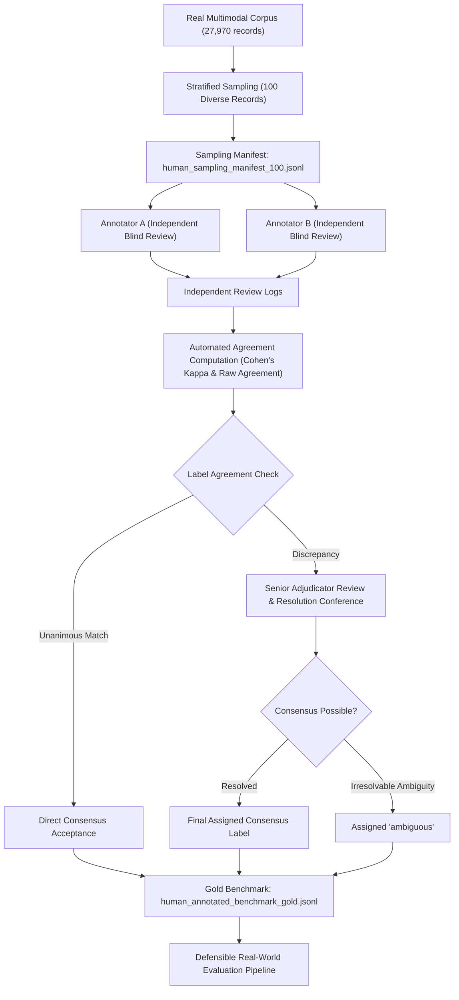

# Phase 4 Human Annotation Workflow & Quality Control Protocol

**Project Title:** Context-Aware Multimodal Passive-Aggression Detection in Social Media Using Image–Comment Fusion  
**Artifact:** `docs/phase4/annotation_workflow.md`  
**Date:** October 21, 2026  
**Version:** 4.0.0  

---

## 1. Objective & Scientific Principles

The objective of this workflow is to construct a **credible, human-audited gold standard evaluation benchmark** for multimodal passive-aggression detection in social media.

### Scientific Guardrails:
1. **Zero Heuristic Labeling:** Sarcasm, sentiment polarity, toxicity scores, or synthetic generators must **never** be converted into passive-aggression ground truth.
2. **Double-Blind Independent Review:** Each candidate record is annotated independently by at least two human reviewers who do not see each other's ratings or prior heuristic labels.
3. **Explicit Ambiguity Support:** Reviewers are never forced to make a binary decision when pragmatic signals are incomplete.
4. **Reproducible Inter-Annotator Metrics:** Inter-annotator agreement metrics (Cohen’s $\kappa$, raw percent agreement) must be computed on raw human logs before adjudication.

---

## 2. Multi-Stage Workflow Architecture

---

## 3. Detailed Stage Procedures

### Stage 1: Stratified Candidate Sampling
- Candidates are drawn across all 4 constituent datasets (`MMSD`, `SarcNet`, `MUStARD`, `Civil Comments`).
- Inclusion criteria:
  - Valid comment text with minimum length of 5 tokens.
  - Image available and decodable (for multimodal instances).
  - Conversation context preserved where available.
- Deduplication:
  - Exact comments, normalized strings, and near-duplicates (Levenshtein ratio > 0.85) are excluded to ensure 100 unique linguistic instances.

### Stage 2: Independent Dual Annotation
1. Annotators receive:
   - `docs/phase4/annotation_guidelines.md`
   - `docs/phase4/annotation_schema.md`
   - Blinded CSV template containing `record_id`, `comment_text`, `image_path`, and `context_text`.
2. Annotators **do not** receive:
   - Model predictions
   - Original dataset sarcasm/toxicity labels
   - Other annotator responses
3. Each annotator independently records:
   - `primary_label` (`passive_aggressive`, `non_passive_aggressive`, `ambiguous`)
   - `subtype` (if passive aggressive)
   - `image_role` (`ESSENTIAL`, `HELPFUL`, `IRRELEVANT`, `ABSENT`)
   - `context_sufficiency` (`SUFFICIENT`, `PARTIAL`, `INSUFFICIENT`)
   - `confidence` (1–5)
   - `evidence_span` (trigger phrase)

### Stage 3: Agreement Calculation & Thresholds
Before adjudication, the script calculates:
- **Raw Agreement ($P_o$):** Fraction of items where both annotators assign identical primary labels.
- **Cohen's Kappa ($\kappa$):**
  $$\kappa = \frac{P_o - P_e}{1 - P_e}$$
  where $P_e$ is the hypothetical probability of chance agreement.
- **Quality Benchmarks:**
  - $\kappa \ge 0.70$: High reliability; proceed to adjudication.
  - $0.50 \le \kappa < 0.70$: Moderate reliability; conduct guideline clarification calibration before adjudication.
  - $\kappa < 0.50$: Low reliability; guidelines must be revised and annotators re-calibrated.

### Stage 4: Adjudication Protocol
1. **Unanimous Cases:** Automatically accepted into the gold standard dataset.
2. **Discrepancy Cases:**
   - A Senior Adjudicator reviews the comments, images, context, and conflicting annotations.
   - If one annotator missed obvious context (e.g., failed to check image contradiction), the mistake is corrected.
   - If both interpretations are pragmatically valid due to underspecified conversational history, the record is adjudicated as `ambiguous`.
   - Adjudication rationale must be logged in `adjudication_notes`.

---

## 4. Current Milestone Status

| Metric / Requirement | Target | Current Status |
|---|---|---|
| Sampled Candidate Instances | 100 | **100 Created** (`human_sampling_manifest_100.jsonl`) |
| Annotation Guidelines Version | v4.0.0 | **Completed** (`annotation_guidelines.md`) |
| Schema Specification | JSON / Pydantic | **Completed** (`annotation_schema.md`) |
| Blinded CSV Template | Available | **Completed** (`annotation_template.csv`) |
| Human Reviewers Engaged | $\ge 2$ | **Pending Human Availability** |
| Completed Verified Annotations | 100 | **0 (Zero)** |
| Inter-Annotator Agreement | $\kappa \ge 0.70$ | **Not Computed (Awaiting Data)** |
| Benchmark Milestone State | - | **`BLOCKED_PENDING_HUMAN_REVIEW`** |

> **Ethical Audit Stance:** The project refuses to fabricate synthetic human reviews or convert sarcasm into ground truth. Evaluation on real data remains blocked until actual human judgments are logged and adjudicated.
