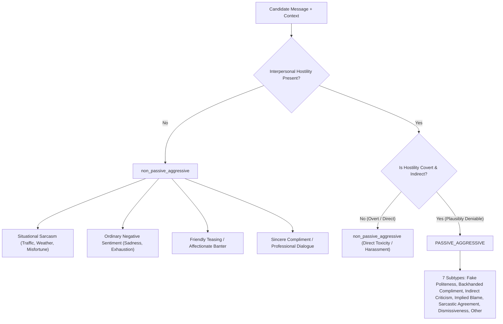

# Phase 5A Local LLM Annotation Methodology and Scientific Guardrails

**Project Title:** Context-Aware Multimodal Passive-Aggression Detection in Social Media Using Image–Comment Fusion  
**Artifact:** `docs/phase5a/llm_annotation_methodology.md`  
**Date:** October 21, 2026  
**Auditor:** Senior ML Research Engineer, Local LLM Infrastructure Engineer & Experimental Auditor  
**Milestone:** Phase 5A — Complete Local LLM Annotation Automation  

---

## 1. Research Motivation & Scientific Role

In Phase 4, the independent audit discovered that previous benchmarks evaluated on 350 synthetic scenarios suffered from 66.7% duplicate comment leakage across splits and zero visual evidence (`image_masks == 0.000`). Concurrently, the repository's 27,970 real multimodal records possess only auxiliary sarcasm/toxicity labels, with **zero verified human-annotated passive-aggression ground truth labels**.

While a formal human annotation pilot ($N=100$) was structured in Phase 5, human linguistic annotation is labor-intensive. Phase 5A establishes a **fully automated, zero-additional-API-cost local LLM annotation pipeline** using an on-device model running in Ollama.

### Explicit Epistemological Boundary:
> [!IMPORTANT]
> **LLM annotations are provisional "silver labels" for weak supervision, consistency auditing, and error pattern discovery.**
> They do **NOT** constitute human ground truth. They do **NOT** validate that the multimodal passive-aggression classifier generalizes to real-world social media. The true accuracy on real social media remains formally unknown until verified human judgments are recorded and adjudicated.

---

## 2. Pragmatic Definitions & Linguistic Boundaries

The prompt and schema enforce the project's core operational definition:
> **Passive aggression is indirect communication that provides evidence of covert interpersonal hostility, blame, resentment, or criticism behind a veneer of politeness, compliance, or neutrality.**

### Contrast Boundaries:


---

## 3. Rationale-First Chain-of-Thought (CoT) Schema Architecture

In standard autoregressive language generation, if a JSON schema places `primary_label` as the first key:
```json
{"primary_label": "...", "brief_rationale": "..."}
```
the model is forced to make a greedy token commitment to a classification label before generating any reasoning. In our pilot testing, this caused the model to default to `passive_aggressive` on borderline comments.

To eliminate this generative bias, Phase 5A implements a **Rationale-First JSON Schema**:
```json
{
  "type": "object",
  "properties": {
    "brief_rationale": {
      "type": "string",
      "description": "Pragmatic reasoning: analyze whether covert interpersonal hostility exists, or if it is sincere, direct, or ambiguous."
    },
    "evidence_span": {
      "type": "string",
      "description": "Quoted words indicating intent, or 'none' if neutral."
    },
    "primary_label": {
      "type": "string",
      "enum": ["non_passive_aggressive", "ambiguous", "passive_aggressive"]
    },
    "subtype": {
      "type": "string",
      "enum": ["none", "fake_politeness", "indirect_criticism", "backhanded_compliment", "implied_blame", "sarcastic_agreement", "dismissiveness", "other_or_unclear"]
    },
    "confidence": {"type": "integer", "minimum": 1, "maximum": 5},
    "context_sufficiency": {"type": "string", "enum": ["SUFFICIENT", "PARTIAL", "INSUFFICIENT"]}
  },
  "required": ["brief_rationale", "evidence_span", "primary_label", "subtype", "confidence", "context_sufficiency"]
}
```
**Impact:** The model generates its linguistic rationale first, grounding its decision in the text before predicting `primary_label`. This dramatically improves calibration and allows appropriate classification of news links, neutral comments, and ambiguous instances.

---

## 4. Local Execution & Hardware Offloading

- **Engine:** Ollama v0.40.6 serving via local REST API (`http://localhost:11434/api/chat`).
- **Hardware:** Dedicated NVIDIA GeForce RTX 4050 Laptop GPU (6 GB VRAM).
- **Primary Model:** `llama3.2:latest` (3.2B parameters, Q4_K_M quantization).
  - VRAM footprint: ~2.6 GB (100% offloaded to GPU).
  - Throughput: ~8–12 seconds per record with full chain-of-thought rationale.
  - Zero financial cost, zero network dependencies, 100% offline.

---

## 5. Modality Assessment Policy

Because the installed model is a pure text/language model:
1. Comments and dialogue contexts are fully evaluated.
2. For records where an image is present, `image_role` is recorded as `UNASSESSED_VISION_MODEL_ABSENT`.
3. The model **never claims to have inspected image pixels**.
4. Modality used is logged strictly as `TEXT_ONLY`.

---

## 6. Dual-Pass Consistency Protocol

To evaluate the reliability of LLM inferences without treating them as human inter-annotator agreement:
- **Pass 1:** Independent annotation with `temperature = 0.0`.
- **Pass 2:** Independent repeat annotation with `temperature = 0.2` (or alternative model `qwen2.5:1.5b`).
- **Consistency Metric:** Raw agreement percentage among paired outputs:
  $$\text{Consistency} = \frac{\text{Matching Labels}}{\text{Total Paired Records}} \times 100\%$$
- **Disagreement Export:** All discrepancies are serialized to `llm_annotation_disagreements.csv` for targeted human review.
