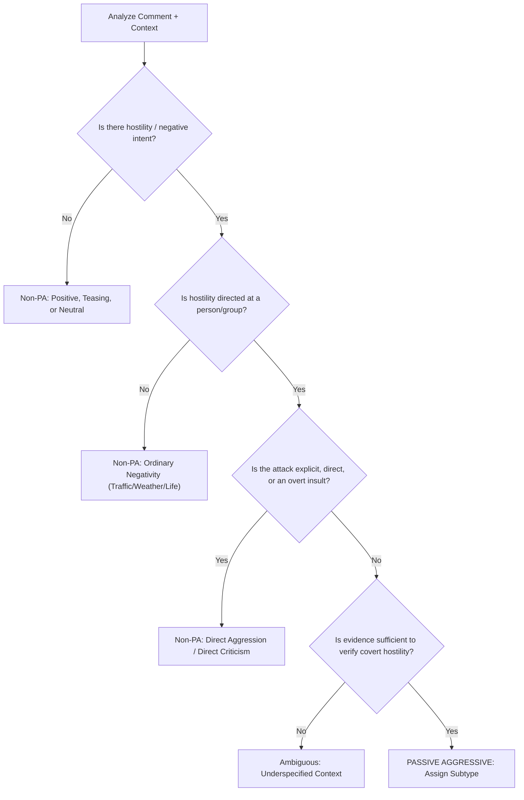

# Multimodal Passive-Aggression Annotation Guidelines

**Project:** Context-Aware Multimodal Passive-Aggression Detection in Social Media Using Image–Comment Fusion  
**Version:** 1.0.0 (Research & Annotation Standard)  
**Target Audience:** Human Annotators, AI Adjudicators, and Data Auditors  

---

## 1. Core Operational Definition

> **Passive Aggression** is indirect, covert, or veiled communication that provides clear textual or contextual evidence of interpersonal hostility, resentment, blame, or criticism, rather than merely expressing negative sentiment, irony/sarcasm, or constructive disagreement.

### Foundational Principles
1. **Hostility Must Be Interpersonal:** Hostility or resentment must be targeted toward a person, group, creator, or conversational partner—not directed at inanimate objects (e.g. traffic, weather, computers).
2. **Communication Must Be Indirect:** If the criticism, insult, or demand is explicit, transparent, and direct, it is **Direct Aggression**, not Passive Aggression.
3. **Evidence-Based Intent Only:** Do not guess private feelings or unstated mental states with certainty. You must point to concrete linguistic or multimodal incongruity evidence.
4. **Preserve Ambiguity:** When the available context is insufficient to distinguish playful teasing, sincere courtesy, or hostility, you **MUST** select `ambiguous`.

---

## 2. Primary Label Schema

Annotators must assign exactly one primary label:

### A. `passive_aggressive`
- Assigned when there is verifiable evidence of covert hostility, masked criticism, resentment, or undermining.
- Requires selecting one secondary subtype.

### B. `non_passive_aggressive`
- Assigned when the text expresses direct criticism, friendly banter, positive emotion, sincere sadness, constructive debate, or neutral feedback.

### C. `ambiguous`
- Assigned when the comment could plausibly be interpreted as either polite, neutral, or hostile, and available multimodal and conversation context is insufficient to calibrate intent.
- Example: "Interesting.", "Very bold choice.", "Noted."

---

## 3. Secondary Subtype Schema

When `passive_aggressive` is selected, annotators must select one of the following subtypes:

| Subtype | Definition | Key Linguistic Signals |
| :--- | :--- | :--- |
| **`fake_politeness`** | Surface-level formal courtesy, excessive etiquette, or warm greetings weaponized to mask contempt, reprimand, or superiority. | *"Per my previous email...", "With all due respect...", "Bless your heart...", "Thank you in advance for finally..."* |
| **`indirect_criticism`** | Veiled attacks, snide remarks, or rhetorical generalizations designed to diminish or criticize without stating the critique overtly. | *"I guess quality is optional now...", "Some people will do anything for attention...", "Interesting how standards change..."* |
| **`backhanded_compliment`** | A compliment paired with a subtle insult, patronizing qualifier, or belittling caveat that undermines the praise. | *"You look surprisingly decent today...", "Impressive work considering your lack of background...", "Better than your usual cooking!"* |
| **`implied_blame`** | Subtly holding someone responsible for a failure, delay, or flaw through loaded phrasing without an overt accusation. | *"Funny how the report is missing right after your shift...", "I love how the tank miraculously empties itself...", "Must be convenient..."* |
| **`sarcastic_agreement`** | Feigning full agreement or enthusiasm to mock, deride, or highlight the absurdity or failure of the poster's action/claim. | *"Oh absolutely, crashing your car was a masterstroke of genius!", "Yes, that burnt crust is true gourmet dining."* |
| **`dismissiveness`** | Curt, invalidating brush-offs designed to deflate pride, dismiss effort, or imply unearned privilege. | *"Must be nice...", "Cool story bro...", "Whatever you need to tell yourself...", "Good for you, I guess."* |
| **`other_or_unclear`** | Passive aggression is clearly present, but does not neatly fit the primary archetypes above. | Mixed or novel indirect communicative attacks. |

---

## 4. Crucial Distinctions and Contrast Classes

Annotators must carefully distinguish passive aggression from superficially similar linguistic behaviors:

### Contrast Class Descriptions:
1. **Sarcasm != Passive Aggression:**
   - *Example:* "Oh wonderful, it's raining on my day off." (Sarcasm about weather = `non_passive_aggressive`).
   - *Contrast:* "Oh wonderful, another meeting scheduled during lunch." (Sarcasm targeting team organizer = `passive_aggressive`).
2. **Toxicity / Direct Aggression != Passive Aggression:**
   - *Example:* "You are an idiot who ruined this project." (Direct hostility = `non_passive_aggressive`).
   - *Contrast:* "I guess competence was too much to ask from this department." (Indirect hostility = `passive_aggressive`).
3. **Ordinary Negativity != Passive Aggression:**
   - *Example:* "I am so exhausted by this flu." (Physical exhaustion = `non_passive_aggressive`).
4. **Friendly Teasing != Passive Aggression:**
   - *Example:* "Bro you missed the easiest goal in history hahaha 😂❤️" (Playful banter with affection cues = `non_passive_aggressive`).
5. **Constructive Disagreement != Passive Aggression:**
   - *Example:* "This sorting implementation has O(n^2) complexity; consider quicksort for better scaling." (Objective professional critique = `non_passive_aggressive`).

---

## 5. Multimodal Context Evaluation Rules

Annotators must always view the **Post Image** and **Preceding Context** alongside the comment:

1. **Visual Incongruity:**
   - If a comment says *"Stunning photography skills!"* on an image of a completely blurry, dark floor, the image confirms sarcasm and indirect criticism.
2. **Visual Mitigating Evidence:**
   - If a comment says *"You look ridiculous"* on an image where both individuals are wearing matching silly Halloween costumes, the image confirms friendly teasing (`non_passive_aggressive`).
3. **When Image is Inaccessible:**
   - Annotator must determine whether text alone provides sufficient evidence. If not, record `ambiguous` with `image_needed_for_interpretation: True`.
