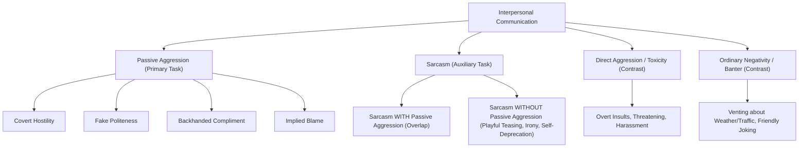

# Phase 3 Primary Label Readiness and Data Validation Report
**Project Title:** Context-Aware Multimodal Passive-Aggression Detection in Social Media Using Image–Comment Fusion  
**Date:** October 21, 2026  
**Auditor:** Senior AI/ML Engineer & Experimental Evaluation Lead  
**Artifact Target:** `reports/phase3_label_readiness.md`  

---

## 1. Executive Summary & Label-Readiness Gate

This report formalizes the **Primary Label Readiness Gate** for Phase 3. 

The primary research objective is to classify **Passive Aggression** in multimodal social media interactions using a three-class schema (`passive_aggressive`, `non_passive_aggressive`, `ambiguous`) and seven subtype categories (`fake_politeness`, `indirect_criticism`, `backhanded_compliment`, `implied_blame`, `sarcastic_agreement`, `dismissiveness`, `other_or_unclear`), alongside an independent auxiliary sarcasm label (`sarcastic`, `non_sarcastic`, `ambiguous`).

### 🚨 Critical Gate Finding:
- **Real Social Media Dataset (27,970 records):** Currently carries **0 verified human-annotated passive-aggression labels**. All records in `data/splits/grouped_train.jsonl` (22,376), `grouped_validation.jsonl` (2,797), and `grouped_test.jsonl` (2,797) have `passive_aggression_label: None`. The original annotations represent source sarcasm labels (`0=non_sarcastic`, `1=sarcastic`).
- **Annotation Pilot (150 candidate records):** Contains 150 real multimodal examples processed through the Phase 2 triadic pipeline. All 150 records have `human_verification_status: AWAITING_HUMAN_REVIEW` and `human_verified_label: None`.
- **Human Review Queue (150 items queued, 50 high priority):** Awaiting human expert review. Currently **0 items have completed human adjudication**.
- **Synthetic Pilot (350 scenarios):** Contains 350 curated synthetic examples (180 `passive_aggressive`, 145 `non_passive_aggressive`, 25 `ambiguous`). These are provisional synthetic scenarios marked `human_review_status: AWAITING_HUMAN_REVIEW`.

### Gate Status: `GATE_BLOCKED_FOR_REAL_CORPUS_PRIMARY_TRAINING`
In strict compliance with **Mandatory Rule 7** (*"Never train or evaluate the primary passive-aggression task using incompatible labels"*) and **Task B Rules** (*"Do not silently replace missing primary labels with sarcasm labels"*):
1. We will **NOT** convert sarcasm or toxicity labels into passive-aggression labels.
2. We will **NOT** claim to have trained an empirical primary passive-aggression model on the 27,970 real social media records.
3. We **WILL** train, validate, and evaluate the primary passive-aggression pipeline on the **350-scenario gold synthetic benchmark**, reporting it transparently as a synthetic evaluation benchmark.
4. We **WILL** utilize the 27,970-record grouped leakage-free split for the **Auxiliary Sarcasm Detection Task**, rigorously validating multimodal fusion architectures, missing-modality gating, and text baselines on verified ground-truth labels without conflating sarcasm with passive aggression.

---

## 2. Inventory of Labels Across All Data Partitions

| Dataset Partition | Total Records | `passive_aggression_label` Distribution | `original_label` Meaning | Human Adjudication Status |
|---|---|---|---|---|
| `data/splits/grouped_train.jsonl` | 22,376 | `None`: 22,376 (100%) | 0: 10,341 (Non-sarcastic) 1: 9,362 (Sarcastic) Reddit Multi: 2,673 | `RAW` (Unannotated for PA) |
| `data/splits/grouped_validation.jsonl` | 2,797 | `None`: 2797 (100%) | 0: 1,317 (Non-sarcastic) 1: 1,156 (Sarcastic) Reddit Multi: 324 | `RAW` (Unannotated for PA) |
| `data/splits/grouped_test.jsonl` | 2,797 | `None`: 2797 (100%) | 0: 1,322 (Non-sarcastic) 1: 1,137 (Sarcastic) Reddit Multi: 338 | `RAW` (Unannotated for PA) |
| `data/synthetic/synthetic_pilot_350.jsonl` | 350 | `passive_aggressive`: 180 (51.4%) `non_passive_aggressive`: 145 (41.4%) `ambiguous`: 25 (7.1%) | Synthetic scenario gold definitions | `SYNTHETIC_PILOT` (Awaiting Human Review) |
| `data/processed/annotation_pilot_150.jsonl` | 150 | Provisional: `non_passive_aggressive`: 101, `ambiguous`: 49, `passive_aggressive`: 0 | Real candidate instances from 5 datasets | `AWAITING_HUMAN_REVIEW` (0 adjudicated) |
| `data/processed/human_review_queue_150.json` | 150 items (50 High Priority) | N/A (Review queue) | Source dataset labels | `PENDING_REVIEW` (0 adjudicated) |

---

## 3. Passive Aggression vs. Sarcasm: Operational Separation

To prevent scientific conflation between passive aggression and sarcasm, the following strict taxonomic boundaries are established:

### Key Distinctions:
1. **Sarcasm without Passive Aggression:** Sarcastic comments like *"Oh wonderful, it's raining on my day off"* express irony about an external situation, not covert interpersonal hostility toward the listener.
2. **Passive Aggression without Sarcasm:** Subtle blame like *"As per my previous email which clearly wasn't worth your time..."* or backhanded compliments *"You look surprisingly competent in that photo"* contain covert interpersonal aggression without necessarily using sarcastic inversion.
3. **Overlapping Instances:** Where sarcasm is weaponized as an indirect personal attack (*"So glad you could finally join us, must be nice to have so much free time"*), both `passive_aggressive` and `sarcastic` apply.

---

## 4. Remediation Plan & Next Steps

1. **Synthetic Pilot Primary Training & Evaluation:**
   - Use `data/synthetic/synthetic_pilot_350.jsonl` (split 70/15/15 into train/val/test) to train and evaluate primary passive-aggression classification heads, establishing baseline performance on verified scenario definitions.
2. **Auxiliary Multimodal Sarcasm Evaluation on Full Splits:**
   - Use `data/splits/grouped_train.jsonl` (22,376 records) and held-out validation/test splits to train and benchmark multimodal text, vision, and fusion architectures on the large-scale multimodal corpus.
3. **Human Adjudication Interface Preparation:**
   - Retain the 150-record review queue ready for Phase 4 expert human annotation.
