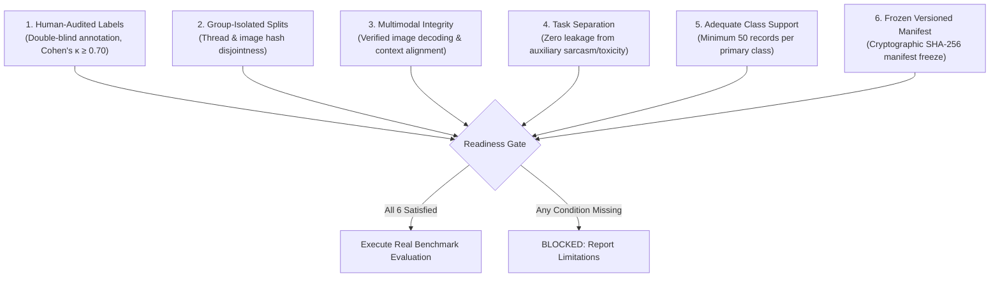

# Phase 4 Real-Data Evaluation Protocol and Generalization Readiness Plan

**Project Title:** Context-Aware Multimodal Passive-Aggression Detection in Social Media Using Image–Comment Fusion  
**Artifact:** `reports/phase4/real_data_evaluation_plan.md`  
**Date:** October 21, 2026  
**Auditor:** Senior ML Research Engineer & Independent Experimental Auditor  
**Status:** `BLOCKED_PENDING_HUMAN_ANNOTATION`  

---

## 1. Executive Summary & Audit Precondition

A central finding of the Phase 3 and Phase 4 audits is that **zero human-verified passive-aggression ground truth labels exist in the 27,970 real multimodal records**. 

Previous benchmarks in the repository relied either on:
1. **Synthetic Scenarios (350 records):** Suffered from 66.7% duplicate comment leakage across splits, inflating test accuracy artificially to 100%.
2. **Auxiliary Sarcasm Classification (MMSD, 7,000 test records):** Evaluated sarcasm, not passive aggression. Sarcasm is fundamentally distinct from covert interpersonal hostility.

Therefore, **it is methodologically invalid to claim that any model in this repository currently generalizes to real-world passive aggression.**

This document establishes the rigorous, defensible protocol required before any real-world evaluation can be reported.

---

## 2. Minimum Credibility Thresholds for Real-World Evaluation

An experimental evaluation on real social media data will be considered valid **only** when all of the following six conditions are met:

### Condition Details:
1. **Direct Task-Specific Ground Truth:** Primary labels (`passive_aggressive`, `non_passive_aggressive`, `ambiguous`) must originate from independent human judgments guided by `docs/phase4/annotation_guidelines.md`. Heuristic conversions from sentiment, toxicity, or sarcasm are strictly prohibited.
2. **Group-Isolated Evaluation Set:** Splitting must be performed on thread IDs (`conversation_id`), post IDs (`post_id`), and perceptual image hashes (`image_sha256`). No two records sharing the same context or visual meme may appear in both the training pool and evaluation pool.
3. **Multimodal Alignment Verification:** All image paths must be verified locally. Images must load and decode without placeholder substitutions or zero tensors. If an image is missing, it must be flagged with `image_available=False` and handled by explicit missing-modality mechanisms.
4. **Decoupling from Auxiliary Tasks:** The real passive-aggression evaluation benchmark must be stored in a dedicated directory (`data/splits/phase4/`) completely separated from the auxiliary sarcasm evaluation splits (`data/splits/phase2/`).
5. **Statistical Power & Class Support:** The evaluation set must contain a minimum of:
   - 50 confirmed `passive_aggressive` instances
   - 50 confirmed `non_passive_aggressive` instances
   - 30 confirmed `ambiguous` instances
   Evaluating on fewer examples renders confidence intervals too wide to detect meaningful model differences.
6. **Immutable Manifest Freeze:** Before running inference, the evaluation manifest must be frozen with a recorded SHA-256 hash.

---

## 3. Human Annotation Status & Gap Analysis

| Parameter | Current Repository State | Target Minimum for Benchmark | Delta / Required Action |
|---|---|---|---|
| Sampled Candidate Records | **100 records** (`human_sampling_manifest_100.jsonl`) | 200–300 records | Sample 100–200 additional records |
| Human-Annotated Records | **0 (Zero)** | 150 adjudicated instances | Complete independent dual review |
| Inter-Annotator Agreement | **None (Not computed)** | Cohen’s $\kappa \ge 0.70$ | Execute agreement script |
| Adjudicated Consensus Set | **0** | 130–150 instances | Conduct senior adjudication conference |
| Multimodal Real Instances | 60 in sampling manifest | $\ge 75$ confirmed | Verify image rendering |

### Current Milestone State:
$$\mathbf{Status = BLOCKED\_PENDING\_HUMAN\_ANNOTATION}$$

Until independent human annotators complete the review of `data/annotations/phase4/human_sampling_manifest_100.jsonl` and reach verified consensus, **no numerical performance claim can be published for real-world passive aggression.**

---

## 4. Evaluation Metrics & Statistical Protocol

When the human-annotated benchmark is unlocked, models will be evaluated strictly according to the following statistical protocol:

### 4.1 Primary Metrics
- **Macro-Averaged F1-Score:** The principal ranking metric across the three classes:
  $$\text{Macro-F1} = \frac{1}{3} \sum_{c \in \{0, 1, 2\}} F1_c$$
- **Balanced Accuracy:** Average of per-class recalls, preventing bias toward dominant majority classes.
- **Expected Calibration Error (ECE):** 10-bin calibration diagnostic assessing whether predicted model probabilities reflect true empirical accuracy.

### 4.2 Non-Parametric Bootstrap Confidence Intervals
All reported metrics must include 95% bootstrap confidence intervals ($B = 1000$ iterations, percentile method):
$$\text{CI}_{95\%} = [\text{Metric}_{2.5\%}, \text{Metric}_{97.5\%}]$$

### 4.3 Abstention & Ambiguity Protocol
- Model predictions with maximum softmax probability below an abstention threshold $\tau$ (e.g., $\tau = 0.50$) or with predicted label `ambiguous` (`class 2`) will be evaluated under selective classification:
  - **Coverage:** Proportion of examples where model commits to a definitive label (`class 0` or `class 1`).
  - **Selective Macro-F1:** Metric computed exclusively on covered examples.

---

## 5. Execution Roadmap

1. **Step 1:** Distribute `docs/phase4/annotation_guidelines.md` and `data/annotations/phase4/annotation_template.csv` to two qualified linguistic reviewers.
2. **Step 2:** Collect independent review files `annotator_01.csv` and `annotator_02.csv`.
3. **Step 3:** Run `scripts/compute_agreement.py` to evaluate Cohen's $\kappa$.
4. **Step 4:** Adjudicate discrepancies and export `data/annotations/phase4/gold_human_benchmark_100.jsonl`.
5. **Step 5:** Unfreeze and run the Phase 4 multimodal evaluation pipeline.
