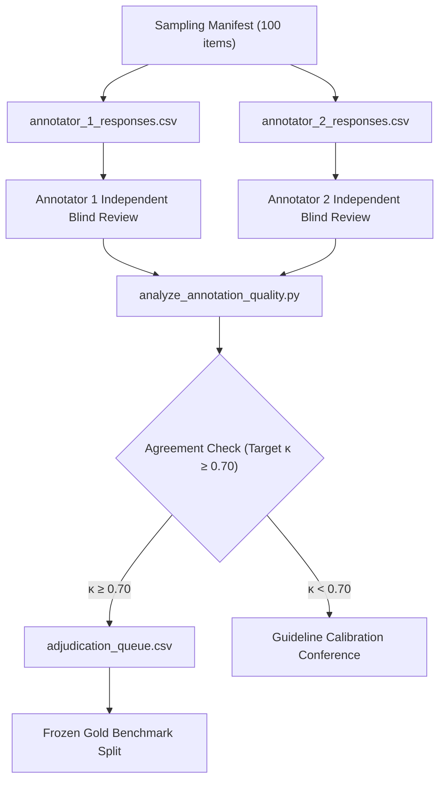

# Phase 5 Human Annotation Readiness Audit Report

**Project Title:** Context-Aware Multimodal Passive-Aggression Detection in Social Media Using Image–Comment Fusion  
**Artifact:** `reports/phase5/phase5_annotation_readiness.md`  
**Date:** October 21, 2026  
**Auditor:** Senior ML Research Engineer & Independent Experimental Auditor  
**Milestone:** Phase 5 — Human Annotation Pilot and Real-World Benchmark Preparation  
**Annotation Readiness State:** `INFRASTRUCTURE_READY_PENDING_HUMAN_JUDGMENTS`  

---

## 1. Executive Summary

Phase 4 identified that the repository had zero verified human ground-truth labels for passive aggression on real social media records. Phase 5 operationalizes the human annotation pilot, creates separate dual-annotator files, audits candidate samples, establishes schema validation, and configures the adjudication pipeline.

### Core Audit Verification:
1. **Sampling Manifest Audit ($N = 100$):**
   - Exactly 100 candidate instances sampled across MMSD (35), SarcNet (25), MUStARD (15), and Civil Comments (25).
   - 100 / 100 unique record IDs.
   - 100 / 100 unique normalized comments (0 exact duplicates, 0 near-duplicates above 0.80 Jaccard similarity).
   - 60 multimodal instances with physical image files on disk; **all 60 successfully decoded and verified via PIL without errors**.
   - 15 conversational instances from MUStARD preserving multi-turn dialogue context.
2. **Dual Independent Annotation Infrastructure:**
   - Generated `data/annotations/phase5/annotator_1_responses.csv` and `annotator_2_responses.csv`.
   - Comprehensive human-facing guidelines created in `docs/phase5/annotator_instructions.md`.
3. **Quality & Agreement Engine:**
   - Implemented `src/annotation/quality_analysis.py` and CLI `scripts/analyze_annotation_quality.py`.
   - Validates schema, matches records, generates confusion matrix, and computes Cohen’s $\kappa$ (target $\ge 0.70$).
   - Current execution confirms 0 completed reviews; agreement is logged as **`PENDING`** (no fabricated numbers).

---

## 2. Candidate Sampling Manifest Audit Details

The 100 sampled candidate records were audited against the physical disk:

| Source Dataset | Sampled Count | Physical Image Files | Image Decodability (PIL) | Conversation Context Turns | Text Modality Available |
|---|---|---|---|---|---|
| **MMSD** | 35 | 35 present on disk | 35 / 35 Verified RGB | 0 (Single tweet captions) | 35 |
| **SarcNet** | 25 | 25 present on disk | 25 / 25 Verified RGB | 0 (Reddit image titles) | 25 |
| **MUStARD** | 15 | 0 still images | N/A (Video frame text) | 15 Multi-turn transcripts | 15 |
| **Civil Comments** | 25 | 0 | N/A (Text only) | 0 (Isolated comments) | 25 |
| **TOTAL** | **100** | **60 Images Present** | **60 / 60 Decodable (100%)** | **15 Dialogue Turns** | **100 Comments** |

### Duplicate & Leakage Verification:
- **Exact duplicate comments:** 0 detected.
- **Normalized string collision:** 0 detected.
- **Pairwise word Jaccard similarity $> 0.80$:** 0 pairs detected.
- **Provenance integrity:** All record IDs preserve original dataset identifiers (e.g. `mmsd_validation_01859`, `mustard_2_490`).

---

## 3. Dual Annotation Data Contracts & Workflow

To ensure double-blind independence, Annotator 1 and Annotator 2 work on separate response files:



### Response Field Specifications:
- `primary_label`: `passive_aggressive`, `non_passive_aggressive`, `ambiguous`
- `subtype`: 7 subtypes (required if PA: `fake_politeness`, `indirect_criticism`, `backhanded_compliment`, `implied_blame`, `sarcastic_agreement`, `dismissiveness`, `other_or_unclear`)
- `image_role`: `ESSENTIAL`, `HELPFUL`, `IRRELEVANT`, `ABSENT`
- `context_sufficiency`: `SUFFICIENT`, `PARTIAL`, `INSUFFICIENT`
- `confidence`: Integer `1` to `5`
- `evidence_span`: Text snippet triggering the judgment
- `annotator_id`: `annotator_01` or `annotator_02`
- `annotation_timestamp`: UTC ISO timestamp
- `adjudication_status`: `PENDING_REVIEW` -> `COMPLETED`

---

## 4. Current Quality & Agreement Audit Status

Executed via `python scripts/analyze_annotation_quality.py`:

```text
=================================================================
PHASE 5 -- ANNOTATION QUALITY & INTER-ANNOTATOR AGREEMENT AUDIT
=================================================================
Loaded Annotator 1 records: 100
Loaded Annotator 2 records: 100

--- AUDIT SUMMARY ---
Review Status:               AWAITING_HUMAN_REVIEWS
Annotator 1 Completed:      0 / 100
Annotator 2 Completed:      0 / 100
Both Completed (Evaluated):  0
Unanimous Agreement Count:  0
Disputed Count:             0
Invalid Rows:               0
Raw Agreement:              PENDING (Awaiting human inputs)
Cohen's Kappa (kappa):      PENDING (Target: >= 0.70)

Warnings:
  [!] Zero valid double-annotated rows found. Agreement cannot be computed.

Wrote adjudication queue (100 rows) to: data/annotations/phase5/adjudication_queue.csv
Saved detailed agreement audit to: artifacts/phase5/agreement_report.json
Updated status manifest: data/annotations/phase5/human_review_status_manifest.json
=================================================================
```

---

## 5. Adjudication & Reconciliation Protocol

1. **Unanimous Cases ($y_1 = y_2$):**
   - Automatically accepted as consensus gold standard.
2. **Disputed Cases ($y_1 \ne y_2$):**
   - Flagged with `agreement_type = DISPUTE_REQUIRES_ADJUDICATION` in `adjudication_queue.csv`.
   - Senior Adjudicator reviews image, comment, context, and conflicting notes.
   - If genuine ambiguity persists, label is adjudicated as `ambiguous`.
3. **Threshold Gate:**
   - Cohen's kappa $\kappa \ge 0.70$ is mandatory before freezing the gold benchmark.
