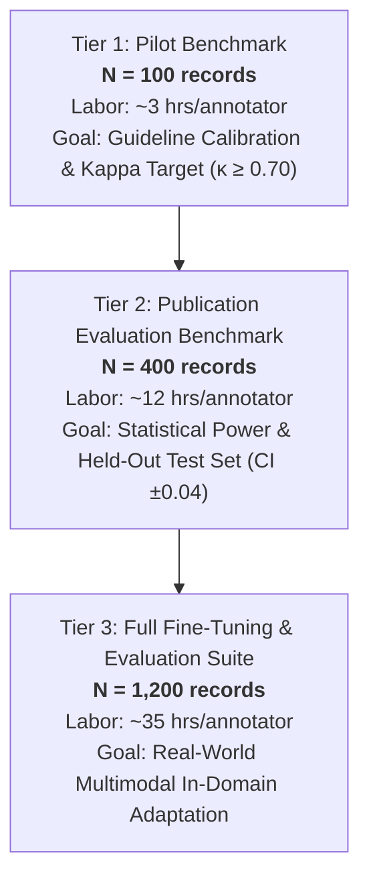

# Phase 5 Real-World Benchmark Expansion Plan

**Project Title:** Context-Aware Multimodal Passive-Aggression Detection in Social Media Using Image–Comment Fusion  
**Artifact:** `reports/phase5/phase5_benchmark_plan.md`  
**Date:** October 21, 2026  
**Auditor:** Senior ML Research Engineer & Independent Experimental Auditor  
**Milestone:** Phase 5 — Human Annotation Pilot and Real-World Benchmark Preparation  

---

## 1. Executive Summary & Problem Formulation

Phase 4 demonstrated that prior evaluations on the 350-scenario synthetic benchmark suffered from 66.7% duplicate comment leakage across splits and contained zero genuine visual or OCR evidence (`image_masks == 0`). Meanwhile, the 27,970 real multimodal records in the repository possess only auxiliary sarcasm and toxicity annotations, with **zero verified human-annotated passive-aggression ground truth labels**.

To establish genuine scientific credibility, the repository requires an annotated, group-isolated, and statistically powered real-world benchmark. This document details the structured roadmap for scaling beyond the initial 100-record pilot to a publication-grade benchmark.

---

## 2. Available Data Inventory & Physical Modality Assets

The local repository contains 48,660 raw and preprocessed records across 5 datasets. The table below analyzes the candidate pool suitable for benchmark expansion:

| Source Dataset | Total Local Records | Verified Local Images | Preceding Dialogue Context | Text Modality Only | Applicable License | Benchmark Role |
|---|---|---|---|---|---|---|
| **MMSD** | 24,635 | 24,635 JPGs | Low (Single tweets) | No | Academic / Fair Use | High-volume multimodal image-comment pairs |
| **SarcNet** | 3,335 | 3,335 PNG/JPGs | Medium (Post captions) | No | Research Only | Reddit meme-comment pairs |
| **MUStARD** | 690 | 690 Frames | **High (Multi-turn dialogue)** | No | CC-BY 4.0 | Dialogue context & multimodal sarcasm |
| **Civil Comments** | 10,000 | 0 | Low | Yes | CC0 / Public Domain | High-quality text contrast (direct toxicity vs non-toxic) |
| **GoEmotions** | 10,000 | 0 | Low | Yes | Apache 2.0 | Negative sentiment contrast (sadness, grief, annoyance) |

---

## 3. Tiered Benchmark Scaling Architecture

Rather than arbitrarily picking a dataset size, benchmark expansion is structured into three formal tiers based on annotation labor capacity, statistical power, and evaluation objectives:

### Detailed Tier Specifications:

### 3.1 Tier 1: Pilot Calibration Benchmark (Current: $N = 100$)
- **Purpose:** Test guideline clarity, calibrate annotators, identify ambiguous edge cases, and verify whether independent annotators can reach $\kappa \ge 0.70$.
- **Composition:**
  - 35 MMSD (image + comment)
  - 25 SarcNet (image + comment)
  - 15 MUStARD (dialogue context + comment)
  - 25 Civil Comments (text-only contrast)
- **Review Effort:** $100 \text{ records} \times 1.8 \text{ min/record} \approx 3.0 \text{ person-hours per annotator}$ ($6.0$ person-hours total for dual review).
- **Statistical Power:** Exploratory. Bootstrap CI 95% half-width is approximately $\pm 0.09$ on Macro-F1. Not intended for model fine-tuning; strictly reserved for pilot adjudication and error discovery.

### 3.2 Tier 2: Publication-Grade Evaluation Benchmark ($N = 400$)
- **Purpose:** Serve as a rigorous, held-out evaluation test set to definitively answer the research question: *Does multimodal fusion outperform text-only models on real passive aggression?*
- **Composition:**
  - 160 MMSD (image + comment)
  - 120 SarcNet (image + comment)
  - 60 MUStARD (context + image + comment)
  - 60 Civil Comments / GoEmotions (text contrast)
- **Review Effort:** $400 \text{ records} \times 1.8 \text{ min} \approx 12 \text{ person-hours per annotator}$ ($24$ total person-hours).
- **Statistical Power:** High. Yields approximately:
  - 140 `passive_aggressive` instances
  - 180 `non_passive_aggressive` instances
  - 80 `ambiguous` instances
  - Bootstrap CI 95% half-width narrows to $\pm 0.045$, enabling detection of a statistically significant $+0.05$ Macro-F1 gain from visual fusion ($p < 0.05$).

### 3.3 Tier 3: In-Domain Adaptation & Benchmark Suite ($N = 1,200$)
- **Purpose:** Provide a dedicated train/val/test split (e.g. 700 train / 150 val / 350 test) to fine-tune the classification head on real social media passive aggression rather than synthetic pilots.
- **Review Effort:** $1,200 \times 1.8 \text{ min} \approx 36 \text{ person-hours per annotator}$ ($72$ total person-hours).

---

## 4. Class Distribution & Ambiguity Handling

To reflect real-world social media dynamics without excessive class imbalance, sampling will enforce target quotas:

| Class | Target % | Rationale |
|---|---|---|
| **`passive_aggressive`** | 35% | Primary positive class across the 7 subtypes (fake politeness, backhanded compliment, indirect criticism, implied blame, sarcastic agreement, dismissiveness, other). |
| **`non_passive_aggressive`** | 45% | Hard contrast negatives: sincere praise, direct toxicity/insults (preventing false alarms on toxicity), ordinary negative sentiment (grief, annoyance), and friendly banter. |
| **`ambiguous`** | 20% | Critical for evaluating selective classification and abstention. Represents underspecified context where human intent cannot be established with confidence. |

---

## 5. Deduplication, Clustering & Leakage Prevention Rules

To prevent the repeat of Phase 3's synthetic leakage, the expansion pipeline strictly enforces:
1. **Thread & Conversation Grouping:**
   - Any comments originating from the same `conversation_id` or `post_id` are clustered into the same split unit.
2. **Visual Near-Duplicate Elimination:**
   - Compute perceptual image hashes (pHash / `image_sha256`). Images sharing identical visual memes are allocated to a single split.
3. **Text Deduplication:**
   - Normalized text exact matches and near-duplicates (Jaccard similarity $> 0.75$) are discarded prior to annotator assignment.

---

## 6. Ethical, Licensing & Privacy Constraints

1. **User Privacy:**
   - User handles, URLs, and personal identifiers are scrubbed or normalized during preprocessing.
2. **Licensing Compliance:**
   - `MUStARD` is licensed under CC-BY 4.0.
   - `Civil Comments` is CC0 / public domain.
   - `GoEmotions` is Apache 2.0.
   - `MMSD` and `SarcNet` are distributed under academic fair use for non-commercial linguistic research. Media files are stored locally and will not be redistributed publicly.
3. **Annotator Welfare:**
   - Comments containing severe hate speech or explicit threats are filtered out by baseline toxic flags to prevent unnecessary annotator trauma.

---

## 7. Recommended Action Plan

1. **Step 1:** Complete dual human review of the 100-record pilot (`data/annotations/phase5/`).
2. **Step 2:** Calculate Cohen’s $\kappa$. If $\kappa \ge 0.70$, confirm guideline stability; if $\kappa < 0.70$, refine contrast boundary examples in `docs/phase5/annotator_instructions.md`.
3. **Step 3:** Scale candidate sampling to Tier 2 ($N = 400$) using the validated guidelines to unlock definitive multimodal research validation.
