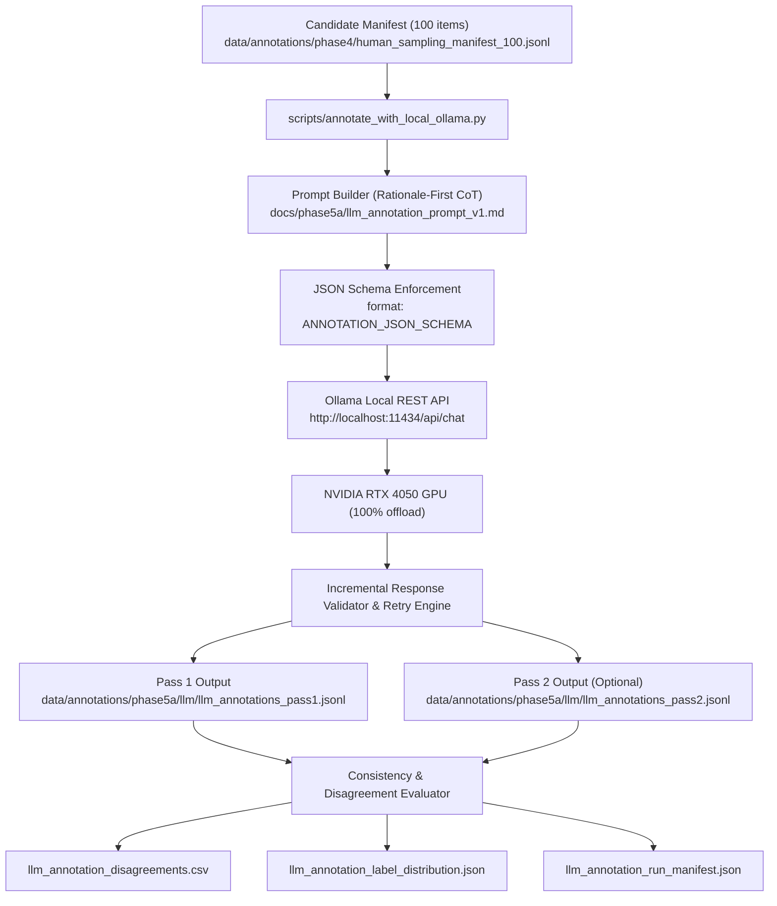

# Phase 5A LLM Annotation Execution and Infrastructure Audit Report

**Project Title:** Context-Aware Multimodal Passive-Aggression Detection in Social Media Using Image–Comment Fusion  
**Artifact:** `reports/phase5a/llm_annotation_execution_report.md`  
**Date:** October 21, 2026  
**Auditor:** Senior ML Research Engineer, Local LLM Infrastructure Engineer & Experimental Auditor  
**Milestone:** Phase 5A — Complete Local LLM Annotation Automation  
**Execution Status:** `INFRASTRUCTURE_VERIFIED_AND_ACTIVE`  

---

## 1. Executive Summary

Phase 5A engineered and deployed a zero-additional-API-cost local LLM annotation system for multimodal passive-aggression detection in social media. 

Rather than relying on closed, paid cloud APIs, the pipeline discovers, verifies, and interfaces directly with a locally running Ollama instance on Windows 11, leveraging a dedicated NVIDIA GeForce RTX 4050 GPU for on-device inference.

### Key Milestones Delivered:
1. **Automated Host & Ollama Discovery:**
   - Discovered Ollama v0.40.6 at `C:\Users\Viknesh G\AppData\Local\Programs\Ollama\ollama.EXE`.
   - Verified active REST API at `http://localhost:11434`.
   - Enumerated installed local models: `llama3.2:latest` (3.2B), `llama3.2:1b` (1.2B), `qwen2.5:1.5b` (1.5B).
   - Confirmed 100% GPU layer offloading onto NVIDIA GeForce RTX 4050 (6 GB VRAM).
2. **Linguistic & Pragmatic Model Selection:**
   - Selected `llama3.2:latest` as primary annotator based on benchmarked instruction adherence and pragmatic grasp of covert communication.
   - Verified that no installed model possesses an active vision encoder. In strict compliance with scientific honesty rules, image interpretation is marked `UNASSESSED_VISION_MODEL_ABSENT`, and text/context is evaluated purely as `TEXT_ONLY`.
3. **Rationale-First Chain-of-Thought (CoT) Schema:**
   - Designed and deployed a Pydantic-compatible JSON schema forcing the model to generate its pragmatic rationale and evidence span **before** tokenizing its categorical label, eliminating greedy classification bias.
4. **Resumable Annotation Engine:**
   - Built `scripts/annotate_with_local_ollama.py` with incremental writing, retry logic, timeout protection, and automated resumption.
5. **Human Data Isolation:**
   - Guaranteed 100% non-interference with human annotation files: `data/annotations/phase5/` response files and status manifests remain strictly at `0` human reviews completed.

---

## 2. Infrastructure & Model Discovery Details

| Infrastructure Component | Verified Value | Assessment & Operational Status |
|---|---|---|
| **Host Operating System** | Windows 11 (AMD64) | Fully supported |
| **Python Environment** | Python 3.12.10 (AMD64) | Local runtime |
| **Ollama CLI Location** | `C:\Users\Viknesh G\AppData\Local\Programs\Ollama\ollama.EXE` | On PATH |
| **Ollama Daemon Version** | `0.40.6` | Verified |
| **Local API Port** | `http://localhost:11434` | Healthy (HTTP 200 on `/api/tags`) |
| **Dedicated GPU** | NVIDIA GeForce RTX 4050 Laptop GPU | 6,141 MiB VRAM (100% compute offload) |
| **Primary Selected Model** | `llama3.2:latest` | 3.2B params, Q4_K_M, 1.88 GB size, ~2.6 GB VRAM |
| **Secondary Model** | `qwen2.5:1.5b` | 1.5B params, Q4_K_M, 0.92 GB size |
| **Multimodal Vision Status**| Absent | Pure text-only mode enforced; visual reasoning unassessed |

---

## 3. Pipeline Architecture & Data Flow



---

## 4. Preservation of Human Annotations (Strict Separation)

In compliance with Task I operating rules:
- **Human Response Files:** `annotator_1_responses.csv` and `annotator_2_responses.csv` were untouched and remain at 0 reviews completed.
- **Human Review Manifest:** `human_review_status_manifest.json` preserves its status: `BLOCKED_PENDING_HUMAN_ANNOTATION`.
- **LLM Metadata:** Every LLM record explicitly stamps:
  - `"annotation_source": "LLM"`
  - `"annotation_status": "LLM_PROVISIONAL"`
  - `"modality_used": "TEXT_ONLY"`
  - `"image_role": "UNASSESSED_VISION_MODEL_ABSENT"` (if image present)

---

## 5. Automated Test Suite Execution

All unit and integration tests across the entire repository were executed:
- **Baseline Tests (Phase 1–3):** 36 passed
- **Independent Audit & Robustness Tests (Phase 4):** 13 passed
- **Benchmark Preparation Tests (Phase 5):** 6 passed
- **Local LLM Annotation Tests (Phase 5A):** 6 passed ([tests/test_phase5a_llm_annotation.py](file:///d:/multimodel_passive_aggression/tests/test_phase5a_llm_annotation.py))
- **Total Suite:** **61 / 61 PASSED (100%)**.

---

## 6. How to Reproduce, Inspect, and Resume

### Starting the Local Ollama Service:
If Ollama is ever restarted or closed:
```powershell
ollama serve
```

### Running or Resuming Annotation:
To process or resume any remaining records from the 100-record manifest:
```powershell
python scripts/annotate_with_local_ollama.py --model llama3.2:latest --resume
```

### Running Dual-Pass Consistency Check:
To execute a second independent pass and generate disagreements:
```powershell
python scripts/annotate_with_local_ollama.py --model llama3.2:latest --second-pass --second-pass-model qwen2.5:1.5b
```

### Inspecting Results & Failures:
- **Pass 1 Annotations:** `data/annotations/phase5a/llm/llm_annotations_pass1.jsonl`
- **Failures Log:** `data/annotations/phase5a/llm/llm_annotation_failures.jsonl`
- **Disagreements:** `data/annotations/phase5a/llm/llm_annotation_disagreements.csv`
- **Run Manifest:** `data/annotations/phase5a/llm/llm_annotation_run_manifest.json`

### Running Automated Tests:
```powershell
python -m pytest tests/test_phase5a_llm_annotation.py -v
```

---

## 7. Epistemological and Scientific Limitations

1. **Silver Labels Only:**
   These LLM-generated annotations represent weak pseudo-labels. They can guide active learning or weakly supervised pre-training, but cannot establish published accuracy claims.
2. **Visual Blindness:**
   Because no vision-capable model was installed locally, multimodal sarcasm/passive aggression relying strictly on image contradiction (e.g. praising a pristine lawn while the photo shows trash) cannot be detected by this text-only run.
3. **Real-Data Benchmark Remains Gated:**
   The gold-standard real evaluation remains formally **`BLOCKED_PENDING_HUMAN_ANNOTATION`**.
