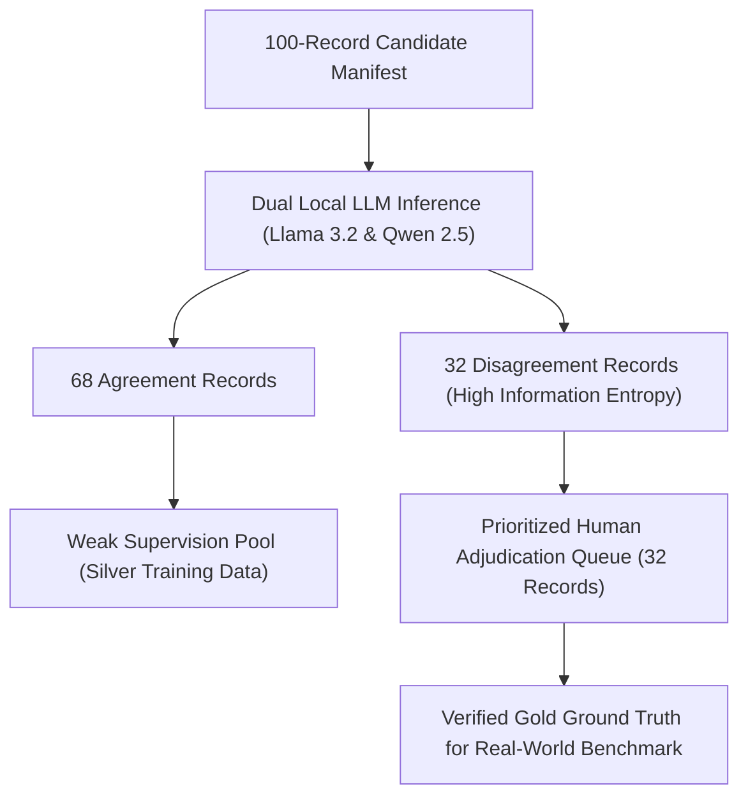

# Phase 5B: Recommendations and Scientific Governance

**Project Title:** Context-Aware Multimodal Passive-Aggression Detection in Social Media Using Image–Comment Fusion  
**Canonical Project Root:** `D:\NLP_PROJECT\passive_aggression_multimodal`  
**Linked Workspace:** `D:\multimodel_passive_aggression`  
**Milestone:** Phase 5B — Strategic Recommendations & Weak-Supervision Roadmap  
**Date:** October 21, 2026  
**Auditor:** Senior ML Research Auditor & Experimental Reliability Team  

---

## 1. Assessment of LLM Silver Labels

### What These Silver Labels ARE:
1. **Algorithmic Consistency Signals:** They reveal where two independent transformer architectures (`llama3.2:3.2b` and `qwen2.5:1.5b`) agree or diverge when given pragmatic definitions of passive aggression.
2. **Pragmatic Edge-Case Detectors:** The 32 disagreement records isolate key boundary ambiguities between direct aggression, rhetorical debate, situational sarcasm, and genuine covert hostility.
3. **Weak-Supervision Pretraining Candidates:** High-confidence consensus records (where both models agree on clear passive aggression or clear non-aggression) can provide auxiliary supervision for feature alignment.

### What These Silver Labels ARE NOT:
1. **NOT Human Ground Truth:** Silver labels cannot serve as ground-truth test labels.
2. **NOT Multimodal Decisions:** Both models were evaluated in text-only mode (`UNASSESSED_VISION_MODEL_ABSENT`). They provide zero evidence regarding image-text incongruity or visual pragmatic cues.
3. **NOT Inter-Annotator Agreement:** The 68.0% agreement between Llama 3.2 and Qwen 2.5 is cross-model algorithmic consistency. It must never be reported as human Cohen's $\kappa$.
4. **NOT Validated Real-World Performance:** Evaluating classifier heads on these silver labels would constitute circular validation (evaluating whether a model mimics LLM biases).

---

## 2. Feasibility of Exploratory Weak-Supervision Experiments

### Recommendation: **CONDITIONALLY SUITABLE**

The silver labels generated in Phase 5A and calibrated in Phase 5B are **suitable for a small, exploratory weak-supervision experiment**, provided the following four non-negotiable scientific constraints are observed:

### Permissible Use:
1. **Auxiliary Representation Learning Only:**
   The consensus records (where Model A and Model B agree under calibrated criteria) may be used as silver training data to explore auxiliary contrastive learning or warm-start classifier heads.
2. **Stratified Negative Sampling:**
   Because Model A in Phase 5A exhibited a 96% positive bias, any weak-supervision training set must be rebalanced using verified non-passive-aggressive records (e.g., from CivilComments neutral splits) to prevent the classifier head from collapsing into predicting passive aggression universally.
3. **Explicit Label Source Tagging:**
   All trained checkpoints must retain explicit provenance tags designating them as weakly supervised (`TRAINED_ON_LLM_SILVER_DATA`).

### Strictly Prohibited Use:
1. **No Evaluation on Silver Labels:**
   The primary multimodal fusion head must never be evaluated against these silver labels to claim benchmark accuracy.
2. **Human Benchmark Remains Gated:**
   The real-world evaluation gate in [human_review_status_manifest.json](file:///d:/multimodel_passive_aggression/data/annotations/phase5/human_review_status_manifest.json) must remain `BLOCKED_PENDING_HUMAN_ANNOTATION` until human reviewers complete their annotations.

---

## 3. High-Value Active-Learning Roadmap: The 32 Disagreement Records

Rather than requiring human annotators to review hundreds of uncurated posts, the 32 disagreement records identified in Phase 5A ([llm_annotation_disagreements.csv](file:///d:/multimodel_passive_aggression/data/annotations/phase5a/llm/llm_annotation_disagreements.csv)) constitute an **optimal active-learning adjudication queue**:

### Strategic Advantage:
By focusing initial human review on these 32 records, researchers resolve the most challenging decision boundaries (factual news vs sarcasm, blunt debate vs implied blame, missing context vs covert intent) with only 32 human evaluations, achieving maximal information gain per annotation minute.

---

## 4. Immediate Next Steps

1. **Human Review of Priority Queue:**
   Provide the 32 disagreement records from [llm_annotation_disagreements.csv](file:///d:/multimodel_passive_aggression/data/annotations/phase5a/llm/llm_annotation_disagreements.csv) to human reviewers using the updated guidelines.
2. **Local Vision Model Integration:**
   When the user is ready to test true multimodal image-text fusion, pull a local vision-capable model in Ollama (such as `llava:7b` or `minicpm-v`) to analyze visual incongruity on the 60 image-containing records.
3. **Benchmark Execution:**
   Unblock the real-world evaluation runner only after human adjudication of the sampling manifest is completed.

---

## 5. Summary Status

- **Phase 5B Silver-Label Quality Audit:** `COMPLETE`
- **Prompt Calibration (Prompt v2.0.0):** `COMPLETE & VALIDATED ON DIAGNOSTIC SUBSET`
- **Repository Automated Test Suite:** `66/66 TESTS PASSING`
- **Human Ground-Truth Benchmark:** `BLOCKED` (as intended, awaiting human review)
