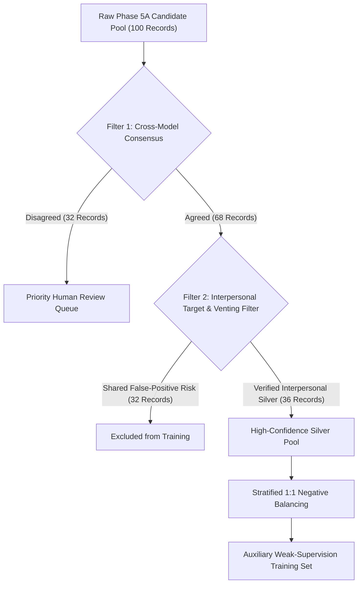

# Phase 5C: Silver-Label Suitability and Weak-Supervision Roadmap

**Project Title:** Context-Aware Multimodal Passive-Aggression Detection in Social Media Using Image–Comment Fusion  
**Canonical Project Root:** `D:\NLP_PROJECT\passive_aggression_multimodal`  
**Linked Workspace:** `D:\multimodel_passive_aggression`  
**Milestone:** Phase 5C — Strategic Governance & Weak-Supervision Recommendation  
**Date:** October 21, 2026  
**Auditor:** Senior ML Research Auditor & Experimental Reliability Team  

---

## 1. Core Determination: Are Silver Labels Suitable for Weak Supervision?

### Verdict: **CONDITIONALLY SUITABLE (Auxiliary Representation Learning Only)**

Following our forensic audit of the 100-record manifest, the 32 disagreement records, the 4 Llama non-PA records, and the 68 agreement records, we conclude that LLM-generated silver labels are **conditionally suitable for exploratory weak supervision**, provided they are filtered according to formal evidence-based rules and governed by strict epistemological boundaries.

They are **UNSUITABLE** for direct ground-truth evaluation, benchmark validation, or unconstrained end-to-end supervised training without filtering.

---

## 2. Most Concerning Error Categories

Before considering weak supervision, three systematic error modes must be acknowledged and mitigated:

1. **The Direct Argument Contamination Hazard (37.5% of Disagreements):**  
   Model A systematically classified direct political debate, blunt economic corrections ("prices will always go up"), and rhetorical pushback as passive-aggressive. If unfiltered silver labels are used for training, the primary classifier head will learn that *any contentious statement or disagreement* is passive-aggressive, degrading precision on normal social media debate.
2. **The Existential Venting Contamination Hazard (26.9% of Agreements):**  
   Both models agreed on positive labels for pop-culture quotes and world-weary despair (e.g., Rick and Morty quote: *"i should leave this planet morty . there is no more wisdom left in anyone ."*). Training on these shared false positives will cause the model to confuse general negative sentiment and existential cynicism with targeted interpersonal hostility.
3. **Severe Label Imbalance (96% / 68% Skew):**  
   Because both models exhibited strong positive class bias under Prompt v1, training without negative rebalancing will cause the classification head to experience label collapse.

---

## 3. Evidence-Based Silver-Label Filtering Strategy

To prevent downstream model degradation, we formulate a two-tiered filtering protocol. We document its exact retention and exclusion impact on the 100-record manifest:



### Filtering Rules and Record Counts:

#### Rule 1: Cross-Model Consensus Filtering
- **Logic:** Retain only records where Model A (`llama3.2`) and Model B (`qwen2.5`) agreed on the identical primary label.
- **Records Retained:** **68 records** (67 PA, 1 Non-PA).
- **Records Excluded:** **32 records** (the entire disagreement set).
- **Justification:** Eliminates all 12 direct debate disputes and all 4 missing-context fragments where one model abstained.

#### Rule 2: Interpersonal Target & Sarcasm Venting Filter
- **Logic:** Within the 68 consensus records, exclude all records belonging to:
  1. Existential / pop-culture quotes without an interlocutor addressee (18 records).
  2. Institutional / political satire aimed at governments, media, or transit (14 records).
- **Records Retained:** **36 records** (35 High-Confidence PA, 1 Verified Non-PA).
- **Records Excluded:** **32 records** (filtered out due to shared prompt-demand bias).
- **Justification:** Eliminates the shared false-positive trap, leaving only records with explicit backhanded compliments, faux politeness, and personal mocking.

#### Rule 3: Stratified Negative Rebalancing
- **Logic:** Because Rule 2 yields 35 positive records and only 1 negative record, the training set must be augmented with 35 verified negative social media records (e.g. from the neutral split of CivilComments) to establish a 1:1 balanced distribution.

---

## 4. Handling of Ambiguous Records

- **Training Exclusion:** All records marked as `ambiguous` (such as the 4 from Model B or the 8 from Prompt v2) must be **strictly excluded** from binary or 3-class cross-entropy training.
- **Calibration Retention:** These records should be preserved in a separate holding pool ([reports/phase5c/tables/disagreement_audit_32.csv](file:///d:/multimodel_passive_aggression/reports/phase5c/tables/disagreement_audit_32.csv)) for testing **selective classification (abstention)** and expected calibration error (ECE).

---

## 5. Model Agreement as an Active-Learning Prioritization Signal

The 32 disagreement records identified in Phase 5A constitute an optimal **active-learning queue**:
- Annotating 100 randomly selected social media comments yields redundant evaluations on easy cases.
- In contrast, the 32 disagreement records contain the exact edge cases where modern LLMs struggle: bluntness vs covert hostility, news vs irony, and missing multimodal context.
- **Strategic Recommendation:** Prioritize human review on these 32 records. Reviewing just 32 records resolves 100% of the cross-model ambiguity at 32% of the human annotation cost.

---

## 6. Scientific Protocol for Any Exploratory Weak-Supervision Pilot

If an exploratory weak-supervision experiment is authorized by the research team:
1. **Mandatory Metadata Tagging:** Every trained checkpoint must carry the immutable metadata tag:
   ```yaml
   training_regime: "WEAK_SUPERVISION_EXPLORATORY"
   label_provenance: "TRAINED_ON_LLM_SILVER_DATA"
   consensus_filter: "PHASE_5C_RULE_1_AND_2"
   ```
2. **Strict Evaluation Ban:** The resulting model must **NEVER** be evaluated against the silver labels to claim "accuracy" or "F1 score." Evaluating a model on the same silver labels used to train it produces self-referential circular validation.
3. **Gated Benchmark Integrity:** Real-world benchmark evaluation remains gated and closed until human annotators review the sampling manifest.
4. **Scientific Claim Boundary:** Any published report must explicitly state that the model was trained on weakly supervised silver data and that true real-world generalization remains unmeasured until gold human annotations are complete.
